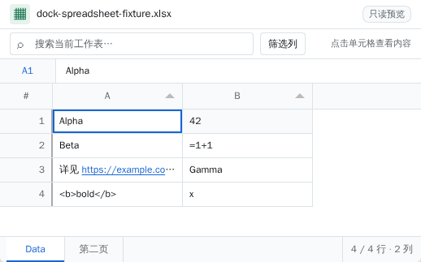
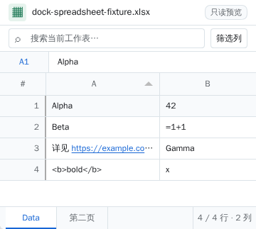

# dock-spreadsheet

[简体中文](README.md) · [English](README.en.md)

[](https://www.npmjs.com/package/dock-spreadsheet) [](LICENSE) 

**A read-only spreadsheet viewer for [dock-files](https://github.com/AKS1st/dock-files).** Open XLSX, XLS, ODS, CSV and TSV files inside the [dock](https://github.com/AKS1st/dock) workbench without uploading them to an external service. Parsing, virtual scrolling and grid interactions use [SheetJS CE](https://docs.sheetjs.com/), [Papa Parse](https://www.papaparse.com/) and [Tabulator](https://tabulator.info/). No runtime CDN requests are required.

> **Scope: read-only preview.** The plugin does not edit or save files, evaluate formulas, or run macros. Since 0.2 it shows formula text, solid fills, column widths, merged ranges and hidden rows/columns/sheets, but it does **not** reproduce fonts, borders, alignment, conditional formatting, charts, images or print layouts; merged cells use an approximation (anchor cell + blank covered cells + an inspector badge).

> For maximum Excel-like fidelity use DeepSeek Harness' built-in right-side document preview. This plugin is a lightweight, searchable, copyable **data browser**; see [Relationship to the native Harness preview](#relationship-to-the-native-harness-preview).

## Screenshots

These screenshots come from a 0.1.x isolated `dsh web` + Chromium run using a synthetic workbook. The 0.2 formula bar, copy/export and refresh controls are not shown.



<details>
<summary>View column filtering</summary>


</details>

<details>
<summary>View the compact 360px window</summary>



</details>

## Features

- **Common file types:** dock-files dispatches `.xlsx`, `.xls`, `.ods`, `.csv` and `.tsv` to the viewer. Switch worksheets using bottom tabs, including arrow keys and Home/End.
- **Read-only formula bar:** select a cell to see the actual formula (preferred) or the displayed text. Program-generated formulas without a cached result show `=formula` plus a “no cache” badge instead of an empty cell.
- **Copy and export:** drag-select a range and press Ctrl/⌘+C (TSV + HTML table, ready to paste into Excel); the toolbar offers “Copy selection / Copy view / Export CSV”.
- **Structure metadata:** column widths, solid fills, number formats, merged ranges (anchor + blank covered cells + inspector badge) and hidden rows/columns. Hidden worksheets stay hidden by default and can be revealed with the “hidden sheets” toggle.
- **Refresh:** the `↻` button re-reads the file. While open, the Host checks the file mtime every 4 seconds and shows “file changed, reload” instead of replacing what you are reading.
- **Find and filter:** search across the current worksheet's data columns, click a column header to sort (numeric/date columns sort by type), and reveal per-column header filters on demand.
- **Link navigation:** recognise `http(s)://`, `www.` and Excel hyperlink objects in cells. **Ctrl+click** (or **⌘+click** on macOS) opens a new tab.
- **Large-sheet preview:** Tabulator's virtual rendering limits DOM nodes to visible rows. The footer shows visible rows/columns, the source totals and a truncated-preview marker.
- **Coordinate fidelity:** keep the original column letters and row numbers for sheets starting at an offset such as `C3`; empty cells remain empty.

### New in 0.2.0

- Formula bar and no-cache formula notice; type-aware numeric/date sorting.
- Range selection, copy selection/view and CSV export.
- Hidden sheet/hidden row/column toggles; column widths, fills and merged-range display.
- Refresh button and change notice; UTF-16 BOM/GBK fallback and delimiter sniffing for CSV/TSV.
- Fixed four invalid CSS tokens that left a white background in dark mode.

## Relationship to the native Harness preview

| Need | Recommended |
| --- | --- |
| Fonts, borders, conditional formatting, charts, maximum Excel fidelity | Harness right-side document preview |
| Fast data lookup, search/filter, copy/export, formula inspection, ODS, lightweight floating window | This plugin |
| Very large or complex workbooks | The native preview is capped at 16 MiB / 250k cells; this plugin accepts 20 MiB but still parses on the main thread, so very large files may pause the UI |

Both can be installed side by side.

## The dock plugin family

dock is a set of composable plugins; this one covers a single capability. Every plugin is optional:

| Plugin | What it does |
| --- | --- |
| [dock-base](https://github.com/AKS1st/dock) | workbench shell: activity bar, side bar, editor area, status bar and the `ctx.workbench` registry |
| [dock-files](https://github.com/AKS1st/dock-files) | file explorer: workspace tree, new/rename/delete, drag-and-drop and clipboard import |
| [dock-editor](https://github.com/AKS1st/dock-editor) | text viewer/editor: undo/redo, Ctrl+S save, binary detection |
| [dock-images](https://github.com/AKS1st/dock-images) | image viewer: PNG/JPEG/GIF/WebP/BMP/SVG/ICO/AVIF |
| [dock-markdown](https://github.com/AKS1st/dock-markdown) | Markdown viewer: GFM rendering, outline, relative-asset resolution |
| [dock-media](https://github.com/AKS1st/dock-media) | audio/video player: HTTP Range streaming, music player and fullscreen video |
| [dock-git](https://github.com/AKS1st/dock-git) | Git history: swimlane graph, branches/tags, stage and commit |
| [dock-spreadsheet](https://github.com/AKS1st/dock-spreadsheet) | read-only spreadsheets: XLSX/XLS/ODS/CSV/TSV |

This plugin is **dock-spreadsheet**; see the "Recommended companion plugins" section of dock-base for full combinations.

## Installation

Requires DSH Web, Node.js ≥20, and the enabled [`dock-base`](https://github.com/AKS1st/dock) and [`dock-files`](https://github.com/AKS1st/dock-files) plugins. **Install all three as top-level plugins in this order:** downloading a base package as a dependency alone does not mount its bundle.

### npm (recommended)

```sh
dsh plugin --profile web add dock-base
dsh plugin --profile web add dock-files
dsh plugin --profile web add dock-spreadsheet
```

### GitHub (alternative)

```sh
dsh plugin --profile web add github:AKS1st/dock
dsh plugin --profile web add github:AKS1st/dock-files
dsh plugin --profile web add github:AKS1st/dock-spreadsheet
```

For local development, use `dsh plugin --profile web add link:/absolute/path/to/dock-spreadsheet`. **After installing or updating, restart dsh web yourself** to ensure the new bundle takes effect; the plugin never restarts your process. The Web profile's `node_modules/dock-spreadsheet` must resolve—merely listing its name as a bundle is not an installation. If the profile is on a read-only mount, make that directory writable before installing.

## Usage

1. Open a supported file in the dock-files explorer. The viewer appears in a dock floating window; it does not add a separate activity-bar item.
2. Click a data cell: the formula bar shows its formula (or `=formula` plus a “no cache” badge); the inspector also shows the address, comment and merged-range markers.
3. Drag-select cells or hold Shift to extend the range, then Ctrl/⌘+C; or use the “Copy selection / Copy view / Export” buttons.
4. Search to filter the current worksheet; click a column header to sort; press the column-filter button to show/hide header inputs.
5. Click a worksheet tab to switch sheets; reveal hidden worksheets/hidden rows and columns with the corresponding toggles.
6. When the file changes externally, click “reload” in the notice, or press `↻` at any time.

## Formats, limits and security

| Topic | Actual behavior |
| --- | --- |
| Excel / OpenDocument | SheetJS CE 0.20.3 reads `.xlsx`, `.xls` and `.ods`; displays cached/formatted text without recalculating formulas. Formula text, solid fills, column widths, hidden rows/columns/sheets and merged ranges are exposed. |
| Delimited text | Papa Parse reads `.csv` and `.tsv`; accepts UTF-8 (with or without BOM), BOM-marked UTF-16, and falls back to GBK when UTF-8 fails; the delimiter (`,`/`\t`/`;`/`|`) is sniffed from the first rows. The first row remains data. |
| Preview window | At most **5,000 rows and 256 columns** from each worksheet's used range; the footer shows source totals and a truncated-preview marker. |
| File access | The Host exposes `POST /dock-spreadsheet/read` for raw bytes and `POST /dock-spreadsheet/stat` for mtime/size. Both check same-origin/trusted-host requests, an absolute path, an allowed extension and a regular file; reads are capped at **20 MiB** and there is no write API. |
| Workspace boundary | Like other dock viewers, the Host may read an **absolute path outside the workspace** referenced by the session. Do not deploy this plugin on an untrusted or publicly reachable Host. |
| Cell rendering | Treat workbook content as untrusted: render via DOM text nodes / `textContent`, never `innerHTML`; `<b>` in a cell stays text. Links use only HTTP(S) and open with `noopener,noreferrer`. |
| Performance | Virtual scrolling reduces DOM work, but parsing still runs on the browser main thread; a complex workbook near the limits may briefly pause the UI. |

This is not a full spreadsheet engine: no editing, saving, collaboration, formula evaluation, macros, chart/image rendering, font/border/alignment/conditional-formatting/frozen-pane fidelity, or automatic encoding detection beyond UTF-8/UTF-16/GBK.

## Development and verification

```sh
pnpm install
pnpm run check   # embed Tabulator styles and check TypeScript
pnpm test        # build Host / Client and run 21 tests
pnpm run build   # produce lib/ for GitHub/npm distribution
```

Unit/integration tests cover all five formats, formulas including no-cache cells, hidden sheets, column widths/merges, UTF-16/GBK/delimiter handling, coordinates and preview limits, Host read/stat guards, browser bundle registration, and a real React + Tabulator mount exercising the formula bar, search, numeric sorting, copy-view, refresh, hidden sheets and link interactions. The isolated-container Chromium checks were **not re-run** after the 0.2 changes; re-run them before a release.

The client artifact bundles SheetJS, Papa Parse, Tabulator and their styles; only platform React remains external in the browser. GitHub consumers use committed `lib/` files, without a consumer build step or `prepare`/`postinstall` script.

## Troubleshooting

| Symptom | Check |
| --- | --- |
| A workbook still opens in the default text viewer | Confirm dock-base, dock-files and dock-spreadsheet are enabled as Web-profile bundles and their packages resolve. Restart dsh web yourself, then reopen the file. |
| Install fails with `EROFS` | The Web profile's `node_modules` is on a read-only filesystem. Make the directory writable and reinstall rather than editing only the manifest. |
| A formula shows `=...` with “no cache” | The file was generated by openpyxl/XlsxWriter and has no saved result; the plugin can only show the formula. Re-save it once in Excel to obtain cached values. |
| CSV/TSV encoding error | Try saving as UTF-8; the viewer also attempts GBK but may still fail. |
| Copy fails | The browser may refuse clipboard writes; focus the page and allow clipboard access, or use “Export CSV”. |
| File rejected or data seems incomplete | Files over 20 MiB are rejected; each sheet previews at most 5,000 rows/256 columns; the footer shows source totals. |
| Ctrl+click does not open a link | The cell text or hyperlink object must contain `http(s)://` or `www.`; check whether the browser blocked a new tab. |

## License and acknowledgements

[MIT](LICENSE). Thanks to [SheetJS CE](https://docs.sheetjs.com/), [Papa Parse](https://www.papaparse.com/) and [Tabulator](https://tabulator.info/).
