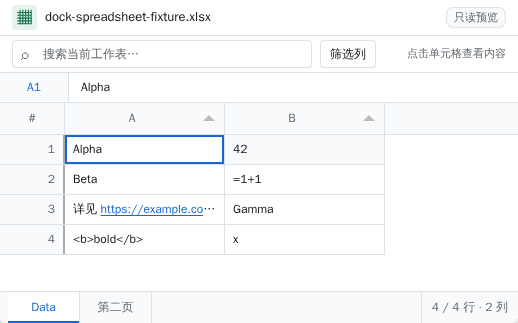
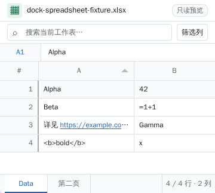

# dock-spreadsheet

[English](README.en.md) · [简体中文](README.md)

[](https://www.npmjs.com/package/dock-spreadsheet) [](LICENSE) 

**为 [dock-files](https://github.com/AKS1st/dock-files) 提供只读在线表格查看器。** 在 [dock](https://github.com/AKS1st/dock) 工作台内打开 XLSX、XLS、ODS、CSV 和 TSV 文件，无需将文件上传到外部服务。使用成熟的 [SheetJS CE](https://docs.sheetjs.com/)、[Papa Parse](https://www.papaparse.com/) 和 [Tabulator](https://tabulator.info/) 实现解析、虚拟滚动与交互；没有 CDN 运行时依赖。

> **范围声明：只读预览。** 本插件不编辑/保存文件，不计算公式或运行宏。0.2 起会展示公式文本、填充色、列宽、合并范围和隐藏行列状态，但**不复刻字体、边框、对齐、条件格式、图表、图片或打印布局**；合并单元格使用“左上格 + 空覆盖格 + 信息栏标注”的近似展示。

> 如果你需要尽可能还原 Excel 外观，请使用 DeepSeek Harness 自带的右栏「文档预览」；本插件定位是轻量、可搜索、可复制的**数据浏览器**，详见[与 Harness 原生预览的关系](#与-harness-原生预览的关系)。

## 效果预览

以下图片来自 0.1.x 的隔离 `dsh web` + Chromium 实际运行，工作簿内容是虚构测试数据；0.2 新增的公式栏、复制/导出和刷新按钮未包含在截图中。



<details>
<summary>查看列筛选效果</summary>


</details>

<details>
<summary>查看 360px 窄浮窗效果</summary>



</details>

## 功能

- **表格格式**：自动接管 dock-files 中的 `.xlsx`、`.xls`、`.ods`、`.csv`、`.tsv` 文件；多工作表通过底部标签切换，支持方向键、Home/End。
- **只读公式栏**：选中单元格后显示实际公式（优先）或显示文本；程序生成、没有缓存结果的公式显示 `=公式` 并标注“无缓存”，不再显示空白。
- **复制与导出**：鼠标拖选区域后 Ctrl/⌘+C 复制（TSV + HTML table，可直接粘回 Excel）；工具栏提供“复制所选 / 复制视图 / 导出 CSV”。
- **结构信息**：展示列宽、填充色、数字格式、合并范围（左上格 + 空覆盖格 + 信息栏标注）和隐藏行列；隐藏工作表默认不显示，可通过“隐藏表”开关查看并标注。
- **刷新**：工具栏 `↻` 重新读取文件；打开期间宿主每 4 秒检查文件 mtime，发现变化时提示“文件已更新，重新加载”，不会在阅读中强制替换内容。
- **查找和筛选**：跨当前工作表数据列搜索；点击列头排序（数字/日期列按类型排序）；按需展开每列的筛选框。收起列筛选时自动清空对应条件。
- **链接导航**：识别单元格文本与 Excel 超链接对象中的 `http://`、`https://` 和 `www.`；**Ctrl+点击**（macOS 为 **⌘+点击**）在新标签页打开。
- **大表预览**：Tabulator 虚拟滚动，仅渲染可见行；底部状态栏显示可见行数、列数、原表总行列和“预览受限”提示。
- **坐标保真**：保留偏移起始工作表的列字母与行号（例如 `C3`）；空白单元格保持为空。

### 0.2.0 新增

- 公式栏、无缓存公式提示；数字/日期列类型排序。
- 区域选择、复制所选/当前视图、导出 CSV。
- 隐藏工作表/隐藏行列开关；列宽、填充色、合并范围展示。
- 刷新按钮与文件变更提示；CSV/TSV 的 UTF-16 BOM、GBK 回退与分隔符嗅探。
- 修复暗色主题下 4 个失效 CSS token 导致的白色背景。

## 与 Harness 原生预览的关系

| 需求 | 建议使用 |
| --- | --- |
| 看字体/边框/条件格式/图表、尽量还原 Excel 外观 | Harness 右栏「文档预览」 |
| 快速找数、搜索/筛选、复制/导出、查看公式、打开 ODS、轻量浮窗 | 本插件 |
| 大文件或复杂工作簿 | 原生预览有 16 MiB / 25 万单元格硬限；本插件支持 20 MiB，但仍在主线程解析，极大文件可能卡顿 |

两侧可以同时安装，互不冲突。

## dock 系列插件

dock 生态是一组可组合的插件，本插件只提供其中一块能力。全部可选，按需安装：

| 插件 | 作用 |
| --- | --- |
| [dock-base](https://github.com/AKS1st/dock) | 工作台基座：活动栏 / 侧边栏 / 编辑器区 / 状态栏与 `ctx.workbench` 注册表 |
| [dock-files](https://github.com/AKS1st/dock-files) | 文件浏览器：会话工作区目录树、新建/重命名/删除、拖放与粘贴导入 |
| [dock-editor](https://github.com/AKS1st/dock-editor) | 文本查看/编辑：撤销重做、Ctrl+S 保存、二进制检测 |
| [dock-images](https://github.com/AKS1st/dock-images) | 图片查看：PNG/JPEG/GIF/WebP/BMP/SVG/ICO/AVIF |
| [dock-markdown](https://github.com/AKS1st/dock-markdown) | Markdown 查看：GFM 渲染、大纲、相对路径资源 |
| [dock-media](https://github.com/AKS1st/dock-media) | 音视频播放：HTTP Range 流式、纯音频播放器与全屏视频 |
| [dock-git](https://github.com/AKS1st/dock-git) | Git 历史：泳道提交图、分支/标签、暂存与提交 |
| [dock-spreadsheet](https://github.com/AKS1st/dock-spreadsheet) | 只读表格：XLSX/XLS/ODS/CSV/TSV |

本插件是 **dock-spreadsheet**；完整组合建议见 dock-base 的「推荐搭配插件」一节。

## 安装

需要 DSH Web、Node.js ≥20，以及已启用的 [`dock-base`](https://github.com/AKS1st/dock) 和 [`dock-files`](https://github.com/AKS1st/dock-files)。**按顺序安装这三个顶层插件**；基础插件仅作为依赖下载并不等于自动挂载。

### npm（推荐）

```sh
dsh plugin --profile web add dock-base
dsh plugin --profile web add dock-files
dsh plugin --profile web add dock-spreadsheet
```

### GitHub（备选）

```sh
dsh plugin --profile web add github:AKS1st/dock
dsh plugin --profile web add github:AKS1st/dock-files
dsh plugin --profile web add github:AKS1st/dock-spreadsheet
```

本地开发可用 `dsh plugin --profile web add link:/absolute/path/to/dock-spreadsheet`。**安装或更新插件后由你重启 dsh web** 才能保证新 bundle 生效；本插件不会自行重启进程。profile 的 `node_modules/dock-spreadsheet` 必须能解析，仅把名字写进 bundle 列表不足以安装；若 profile 位于只读挂载，先解决文件系统可写性。

## 使用方法

1. 在 dock-files 文件浏览器中打开受支持的表格文件，查看器会以 dock 浮窗打开。无需另外寻找活动栏入口。
2. 点击数据单元格：公式栏显示公式（无缓存时显示 `=公式` 和“无缓存”）；信息栏同时给出坐标、批注/合并范围标记。
3. 拖选单元格或按住 Shift 扩展选区，Ctrl/⌘+C 复制；也可以点“复制所选 / 复制视图 / 导出”按钮。
4. 搜索框筛选当前工作表；点击列头排序；点击“筛选列”显示/收起列头筛选输入框。
5. 点击底部工作表标签切换；隐藏工作表通过“隐藏表”按钮显示；隐藏行列通过“隐藏行列”按钮显示。
6. 文件被外部修改后，出现“文件已更新”提示时点“重新加载”，或随时点 `↻` 重读。

## 格式、边界与安全

| 项目 | 实际行为 |
| --- | --- |
| Excel / OpenDocument | SheetJS CE 0.20.3 读取 `.xlsx`、`.xls`、`.ods`；显示公式缓存/格式化文本，不重新计算公式；公式文本、填充色、列宽、隐藏行列/工作表、合并范围可读取。 |
| 分隔文本 | Papa Parse 读取 `.csv`、`.tsv`；支持 UTF-8（含 BOM）、带 BOM 的 UTF-16，UTF-8 失败时回退 GBK；按首行数据嗅探分隔符（`,`、`\t`、`;`、`|`）。第一行是数据而非自动表头。 |
| 预览范围 | 每张表从已使用区域起最多预览 **5000 行、256 列**；状态栏显示原表总行列和“预览受限”。 |
| 文件访问 | Host 提供 `POST /dock-spreadsheet/read` 读取原始字节与 `POST /dock-spreadsheet/stat` 返回 mtime/size；均校验同源/可信主机、绝对路径、允许扩展名、常规文件；读取有 **20 MiB** 上限，无写入 API。 |
| 工作区边界 | 与其他 dock 查看器一致，允许读取会话指向的**工作区外绝对路径**；请勿将插件装入不可信或公开可访问的 Host。 |
| 内容渲染 | 工作簿内容按不可信数据处理：文本通过 DOM `textContent`/文本节点输出，不使用 `innerHTML`；链接仅允许 HTTP(S) 并以 `noopener,noreferrer` 打开。 |
| 性能 | 虚拟滚动降低 DOM 开销，但解析仍在浏览器主线程进行；接近上限的复杂工作簿可能短暂卡顿。 |

本插件不是完整电子表格引擎：不提供编辑、保存、协同、公式求值、宏执行、图表/图片渲染、字体/边框/对齐/条件格式/冻结窗格复刻，也不支持非 UTF-8/UTF-16/GBK 的其他编码自动猜测。

## 开发与验证

```sh
pnpm install
pnpm run check   # 生成内嵌 Tabulator 样式并检查 TypeScript
pnpm test        # 构建 Host / Client 并运行 21 项测试
pnpm run build   # 生成需随 GitHub/npm 发布的 lib/
```

单元/集成测试覆盖五种文件格式、公式与无缓存公式、隐藏工作表、列宽/合并、CSV UTF-16/GBK/分隔符、坐标与预览上限、Host 读取/stat 防线、浏览器 bundle 注册，以及真实 React + Tabulator 挂载后的公式栏、搜索、数字排序、复制视图、刷新、隐藏表和链接交互。0.2 改动后**未复跑**隔离容器里的 Chromium 全量检查；发布前建议按原有方式补跑。

客户端产物内置 SheetJS、Papa Parse、Tabulator 和样式；浏览器端只将平台提供的 React 保留为外部依赖。GitHub 安装使用仓库已提交的 `lib/`，不需要消费者运行构建脚本，也不声明 `prepare`/`postinstall`。

## 故障排查

| 现象 | 排查 |
| --- | --- |
| 文件仍被默认文本查看器打开 | 检查 dock-base、dock-files、dock-spreadsheet 均在 Web profile 的 bundle 列表且依赖可解析；由你重启 dsh web 后再打开。 |
| 安装时报 `EROFS` | Web profile 的 `node_modules` 位于只读文件系统；使该目录可写后重新安装，不要只改清单。 |
| 公式显示 `=...` 并带“无缓存” | 文件由 openpyxl/XlsxWriter 等程序生成、没有保存计算结果；插件只能显示公式，无法重算。用 Excel 打开并保存一次即可得到缓存值。 |
| CSV/TSV 编码错误 | 先尝试另存为 UTF-8；插件也会尝试 GBK，但仍可能失败。 |
| 复制失败 | 浏览器可能拒绝剪贴板写入；确认页面有焦点并允许剪贴板权限，或改用“导出 CSV”。 |
| 文件太大或未显示全部数据 | 单文件不能超过 20 MiB；每张表最多预览 5000 行/256 列，状态栏会显示原表总行列。 |
| Ctrl+点击没打开网页 | 确认单元格文本或超链接对象具有 `http(s)://` 或 `www.` 前缀，且浏览器没有拦截新标签页。 |

## 许可与致谢

[MIT](LICENSE)。感谢 [SheetJS CE](https://docs.sheetjs.com/)、[Papa Parse](https://www.papaparse.com/) 与 [Tabulator](https://tabulator.info/) 项目。
